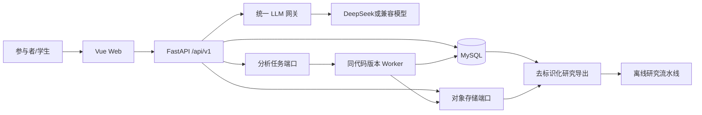

# 心迹AI项目架构与开发基线

版本：2.0

状态：已接受，所有新代码必须遵守

生效日期：2026-10-12

适用范围：Web 前端、后端 API、笔迹采集、离线数据处理、模型实验、测试和部署。

## 1. 这份文档怎么用

本文是队友克隆仓库后编写代码的第一规范。它回答四个问题：

1. 新功能应该放在哪个目录；
2. 一个文件应该负责什么、何时必须拆分；
3. 模块之间怎样调用，哪些数据可以保存；
4. 提交前必须完成哪些测试和文档更新。

约束词含义：

- **必须**：不得自行偏离；确需改变时先提交 ADR。
- **应该**：默认遵守；偏离时在评审中写明原因。
- **可以**：按任务复杂度选择。

发生冲突时，优先级依次为：法律与伦理要求、本文件、数据采集规范、API 契约、模块 README、实现代码。立项报告定义目标，本文件定义软件实现方式。

## 2. 当前状态与目标状态

项目采用**研究型模块化单体**，不是微服务项目：

- 一个 Vue 3 Web 前端；
- 一个 FastAPI 后端代码库；
- 一个 MySQL 业务数据库；
- 一个对象存储接口，用于大体积轨迹、图像和导出文件；
- 一个统一 LLM 网关；
- 离线研究代码与线上服务完全分离。

当前仓库仍有少量原型期扁平文件，例如 `frontend/src/App.vue`、`backend/app/models.py` 和 `backend/app/schemas.py`。它们属于**待迁移兼容层**：

- 不进行没有业务收益的一次性重写；
- 修改某项功能时，把该功能迁入本文件规定的目录；
- 不再向扁平文件继续堆叠新的完整功能；
- 迁移后删除旧入口并补充回归测试。

## 3. 架构目标

发生取舍时按以下顺序决策：

1. 参与者安全、隐私和伦理；
2. 数据正确、可追踪、可撤回；
3. 核心流程可运行并可安全降级；
4. 研究结果可复现、标签不混用；
5. 代码可读、模块边界清楚、测试可维护；
6. 性能和扩展能力；
7. 技术新颖性。

当前不引入 Kubernetes、Kafka、服务网格、多套后端语言或为每个模块单独部署服务。新增依赖必须解决已经出现的问题。

## 4. 系统上下文



### 4.1 开发拓扑

```text
frontend + api + mysql
TASK_MODE=inline
OBJECT_STORAGE_DRIVER=local
LLM_MODE=mock
```

### 4.2 集成和用户测试拓扑

进入正式用户测试或批量分析后才增加：

```text
worker + redis + S3-compatible object storage
TASK_MODE=celery
OBJECT_STORAGE_DRIVER=s3
```

API 和 Worker 必须使用相同镜像、代码版本、Schema 和配置格式。Redis 只传递任务消息，不能保存最终业务状态。

## 5. 业务模块与数据所有权

| 模块 | 职责 | 拥有的数据 |
| --- | --- | --- |
| `identity` | 注册、登录、退出、会话和当前用户 | 用户、会话 |
| `consent` | 知情同意、授权版本、撤回和删除申请 | 授权记录、隐私申请 |
| `wellbeing` | 当前压力、心情、睡眠和趋势 | 状态记录 |
| `journal` | 电子手账 CRUD | 手账记录 |
| `chat` | 支持性对话、上下文和安全分流 | 对话会话与消息 |
| `handwriting` | 数位板任务、轨迹接收、质量和客观特征 | 笔迹会话与特征 |
| `questionnaire` | 量表版本、逐题回答和计分 | 量表施测记录 |
| `htp` | 房树人结构化采集与非诊断观察 | HTP 记录 |
| `sandplay` | 沙盘元素、布局和回看 | 沙盘记录 |
| `content` | 冥想、瑜伽、科普及进度 | 内容及进度 |
| `analysis` | 通用分析任务、状态和结果索引 | 分析任务与结果 |
| `audit` | 安全操作和模型调用元数据 | 审计日志 |
| `research_export` | 去标识化导出和清单 | 导出任务与清单 |

同一概念只能有一个数据所有者。模块不得直接读取其他模块的 ORM Model；跨模块查询通过对方公开的应用服务、只读接口或领域事件完成。

## 6. 仓库目录基线

```text
mindtrace-campus/
├─ frontend/                   # Vue Web 应用
├─ backend/                    # FastAPI 线上服务
├─ research/                   # 离线研究资产和未来数据适配器
├─ tests/                      # 当前跨模块回归测试
├─ docs/                       # 项目唯一正式文档区
├─ docker-compose.yml
├─ pyproject.toml
├─ .env.example
├─ AGENTS.md                   # 仓库操作流程
└─ README.md                   # 项目入口和快速启动
```

根目录不得新增临时说明、会议记录、数据文件、模型、数据库或一次性脚本。文档放入 `docs/` 对应主题；研究脚本放入 `research/`；运维脚本未来统一放入 `scripts/`。

### 6.1 文档目录

```text
docs/
├─ README.md
├─ 01-product/
│  ├─ README.md
│  ├─ feature-list.md
│  └─ requirements.md
├─ 02-architecture/
│  └─ README.md
├─ 03-data/
│  ├─ README.md
│  └─ handwriting-collection-and-dataset-spec.md
├─ 04-api/
│  └─ README.md
├─ 05-ai/
│  └─ README.md
├─ 06-development/
│  ├─ README.md
│  └─ setup-guide.md
└─ 07-collaboration/
   ├─ README.md
   └─ decisions/
```

不得在 `docs/` 根目录重新创建“新版架构”“最终代码规范”“临时需求”等重复文件。更新现有主题文档，重大决策写 ADR。

## 7. 后端结构

目标结构：

```text
backend/
├─ app/
│  ├─ main.py
│  ├─ api/
│  │  ├─ dependencies.py
│  │  └─ router.py
│  ├─ core/
│  │  ├─ config.py
│  │  ├─ database.py
│  │  ├─ errors.py
│  │  ├─ logging.py
│  │  └─ security.py
│  ├─ shared/
│  │  ├─ types.py
│  │  └─ ports/
│  │     ├─ llm.py
│  │     ├─ object_storage.py
│  │     └─ task_dispatcher.py
│  ├─ modules/
│  │  ├─ identity/
│  │  ├─ consent/
│  │  ├─ wellbeing/
│  │  ├─ journal/
│  │  ├─ chat/
│  │  ├─ handwriting/
│  │  ├─ questionnaire/
│  │  ├─ htp/
│  │  ├─ sandplay/
│  │  ├─ content/
│  │  ├─ analysis/
│  │  ├─ audit/
│  │  └─ research_export/
│  ├─ infrastructure/
│  │  ├─ llm/
│  │  ├─ storage/
│  │  ├─ tasks/
│  │  └─ crypto/
│  └─ workers/
├─ migrations/
└─ tests/
   ├─ unit/
   ├─ integration/
   ├─ contract/
   └─ security/
```

每个业务模块按需要采用：

```text
module_name/
├─ api.py             # HTTP 参数、认证依赖和响应映射
├─ schemas.py         # Pydantic 请求/响应模型
├─ service.py         # 用例编排和事务边界
├─ domain.py          # 不依赖框架的业务规则
├─ models.py          # 本模块 ORM Model
├─ repository.py      # 数据访问接口与实现
├─ permissions.py     # 归属和授权规则
└─ tasks.py           # 可选后台任务入口
```

简单模块可以省略空文件，但不能把路由、数据库、外部 API 和业务规则重新塞进一个文件。

### 7.1 后端依赖方向

```text
api → service → domain
              → repository interface → database adapter
              → shared port → infrastructure adapter
```

必须遵守：

- API 路由不直接执行 SQL，不直接请求 LLM 或对象存储；
- Domain 不导入 FastAPI、SQLAlchemy、Celery、Redis 或供应商 SDK；
- Service 拥有事务边界和用例编排；
- Repository 查询敏感数据时必须包含所有者条件；
- Infrastructure 只实现端口，不承载产品规则；
- `shared` 不得成为任意代码的堆放区。

### 7.2 后端文件大小

| 类型 | 建议上限 | 强制评审线 | 超出后的处理 |
| --- | ---: | ---: | --- |
| Python业务文件 | 250 行 | 350 行 | 按职责拆分 |
| API路由文件 | 180 行 | 250 行 | 按资源或用例拆路由 |
| Domain/Service | 250 行 | 350 行 | 拆值对象、规则或用例服务 |
| 单个函数 | 40 行 | 70 行 | 提取命名明确的纯函数 |
| 测试文件 | 350 行 | 500 行 | 按被测行为拆分 |

空行和注释计入行数。迁移文件、生成代码和纯常量表可以例外，但必须在文件头说明来源。新代码超过强制评审线不得直接合并；应先拆分或在 ADR 中解释。

## 8. 前端结构

目标结构：

```text
frontend/src/
├─ app/
│  ├─ router/
│  ├─ stores/
│  └─ bootstrap/
├─ api/
│  ├─ client.js
│  ├─ errors.js
│  └─ generated/
├─ features/
│  ├─ auth/
│  ├─ consent/
│  ├─ wellbeing/
│  ├─ journal/
│  ├─ chat/
│  ├─ handwriting/
│  ├─ questionnaire/
│  ├─ htp/
│  ├─ sandplay/
│  └─ content/
├─ shared/
│  ├─ components/
│  ├─ composables/
│  ├─ validation/
│  └─ styles/
├─ App.vue
└─ main.js
```

一个前端功能目录内部可以包含：

```text
handwriting/
├─ pages/
├─ components/
├─ composables/
├─ api.js
├─ schema.js
├─ constants.js
└─ __tests__/
```

规则：

- 页面负责布局和用例编排，不直接实现轨迹算法；
- 可复用 UI 放 `components`，状态逻辑放 `composables`；
- 功能 API 集中在该功能的 `api.js`，底层 HTTP 统一走 `api/client.js`；
- 不在组件中拼接后端地址、读取模型密钥或复制后端错误码；
- 原始 Pointer Events 采集与 Canvas 绘制分开，显示平滑不能改变上传数据；
- `App.vue` 只保留应用壳、路由出口和全局布局，不继续添加完整业务页面。

### 8.1 前端文件大小

| 类型 | 建议上限 | 强制评审线 | 超出后的处理 |
| --- | ---: | ---: | --- |
| Vue页面 | 250 行 | 350 行 | 拆业务组件和 composable |
| Vue组件 | 180 行 | 250 行 | 拆展示区块或交互单元 |
| JS/TS逻辑文件 | 200 行 | 300 行 | 按领域职责拆分 |
| composable | 150 行 | 220 行 | 拆采集、上传、校验等职责 |
| 全局样式文件 | 300 行 | 450 行 | 迁移到功能或组件样式 |

组件不是越小越好。只使用一次、少于约 30 行且没有独立行为的片段不必机械拆分。

## 9. 笔迹采集模块边界

笔迹功能必须拆成以下职责，不能放在一个 Canvas 组件中：

```text
features/handwriting/
├─ pages/HandwritingSessionPage.vue
├─ components/
│  ├─ DeviceCheckPanel.vue
│  ├─ WritingCanvas.vue
│  ├─ TaskInstruction.vue
│  └─ QualitySummary.vue
├─ composables/
│  ├─ usePointerCapture.js
│  ├─ useHandwritingSession.js
│  └─ useOfflineBuffer.js
├─ domain/
│  ├─ normalizePointer.js
│  ├─ buildTrace.js
│  └─ qualityRules.js
├─ api.js
└─ constants.js
```

- `WritingCanvas`：只绘制和转发事件；
- `usePointerCapture`：处理 pointer capture、coalesced events 和时钟；
- `normalizePointer`：生成原始值与归一化值；
- `buildTrace`：按照版本化 Schema 组装上传数据；
- `qualityRules`：只做前端即时提示，服务端必须重新校验；
- `useOfflineBuffer`：处理断网暂存、重试和成功后清理；
- `api.js`：提交会话和读取结果。

具体任务、量表、设备字段和质量阈值以[笔迹数据集与数位板采集规范](../03-data/handwriting-collection-and-dataset-spec.md)为准。

## 10. 离线数据与研究代码

`research/` 不被线上 API 导入。新的数据工具按统一适配器架构建立：

```text
research/
├─ datasets/
│  ├─ adapters/
│  │  ├─ base.py
│  │  ├─ quickdraw.py
│  │  ├─ casia_ondo.py
│  │  └─ emothaw.py
│  ├─ schemas/
│  ├─ validation/
│  └─ registry/
├─ features/
├─ experiments/
├─ evaluations/
├─ ai/
└─ artifacts/                 # Git忽略
```

每个公开数据集有独立适配器，但输出统一中间 Schema：

```text
官方原始文件（只读）
  → 数据集专用 adapter
  → normalized trace
  → 公共 Schema 校验
  → 公共质量检查
  → 公共特征提取
  → 参与者隔离的数据划分
  → 实验配置和报告
```

适配器只负责解析、字段映射和来源登记，不负责训练。推荐公共接口：

```python
class DatasetAdapter(Protocol):
    source_id: str

    def iter_samples(self, source_root: Path) -> Iterator[NormalizedSample]: ...
    def build_manifest(self, source_root: Path) -> DatasetManifest: ...
```

必须遵守：

- 原始文件只读，不原地清洗；
- 没有的压力、倾角或参与者字段写 `null`，不得伪造默认值；
- 原数据标签保留原名称和量表版本，不跨量表换算；
- 外部数据用于预训练，最终监督拟合以真人目标域数据为主；
- 大规模中间结果使用 Parquet 或压缩 JSONL，避免数百万小文件；
- 下载数据、真人数据、模型权重和缓存全部位于 Git 仓库之外或被忽略目录。

旧版华为平板、旧 1—5 分标签和《笔迹心理学》RAG 脚本已经移除。统一 Schema 2.0 冻结前，不新建临时转换脚本。

## 11. 数据架构与隐私

| 类型 | 存储 | 示例 |
| --- | --- | --- |
| 业务结构化数据 | MySQL | 用户、授权、状态、量表元数据、任务状态 |
| 小型分析摘要 | MySQL | 质量结果、特征摘要、模型版本 |
| 原始或大型数据 | 对象存储 | 轨迹、绘画、导出包 |
| 临时任务消息 | Redis | `job_id`、任务类型、追踪标识 |
| 研究数据和模型 | 受控研究存储 | 去标识化数据、特征、权重 |

### 11.1 数据等级

| 等级 | 数据 | 要求 |
| --- | --- | --- |
| L0 | 已审核公开内容 | 可公开分发 |
| L1 | 配置元数据和聚合指标 | 团队内部访问 |
| L2 | 账号和偏好 | 鉴权、归属校验、可删除 |
| L3 | 对话、手账、量表、笔迹和分析结果 | 最小采集、加密、严格审计 |
| L4 | 参与者身份映射 | 与研究数据隔离、最小人员访问 |

真实姓名、学号、联系方式、原始笔迹、量表回答、对话和身份映射不得进入 Git、日志、普通测试夹具或截图。

### 11.2 通用约束

- 对外 ID 使用不可预测的 UUID；
- 时间保存为 UTC，API 使用带时区 ISO 8601；
- 分析结果记录 Schema、特征、模型、Prompt 和安全策略版本；
- 数据删除覆盖数据库、对象存储、缓存、待执行任务和身份映射；
- 数据库事务中不得执行外部 LLM、长文件处理或网络上传；
- 原始轨迹与派生特征分开，派生结果可重建。

## 12. API 规范

- 业务前缀统一为 `/api/v1`；
- JSON 字段统一使用 `snake_case`；现有驼峰研究 Schema 在升级时显式做版本迁移；
- OpenAPI 和 JSON Schema 是前后端契约源；
- 列表接口必须分页并说明排序；
- 错误使用稳定业务错误码，不暴露 Python 异常、SQL 或上游正文；
- 创建分析、导出和删除任务必须支持幂等；
- 敏感资源查询在数据库条件中同时限制所有者；
- 耗时分析返回任务资源，不保持长时间 HTTP 请求。

统一错误结构：

```json
{
  "error": {
    "code": "RESOURCE_NOT_FOUND",
    "message": "未找到请求的资源",
    "request_id": "req_...",
    "details": []
  }
}
```

## 13. AI 与模型边界

所有外部模型调用经过统一 `LlmGateway`。业务模块不得直接读取模型密钥或拼接供应商 URL。

网关负责：

- 模型和供应商选择；
- 超时、有限重试和限流；
- 输入最小化和去标识化；
- Prompt 与模型版本；
- 结构化输出校验；
- 医疗越界和安全规则；
- Mock 与降级；
- 不含敏感正文的审计。

笔迹模型必须区分：

- `quality`：数据是否可用；
- `feature`：客观行为特征；
- `prediction`：经过真人目标域验证的实验预测；
- `explanation`：对已有结果的安全表达。

LLM 不负责计算笔压和速度，不生成训练标签，不把笔迹解释成人格或疾病。没有达到预设评估门槛时，产品只显示客观特征和局限。

## 14. 测试架构

| 测试 | 覆盖内容 | 外部依赖 |
| --- | --- | --- |
| 单元测试 | 领域规则、轨迹算法、量表计分、权限 | 无网络 |
| 集成测试 | Repository、迁移、对象存储、任务适配器 | 隔离服务 |
| 契约测试 | OpenAPI、JSON Schema、错误码 | Mock |
| 安全测试 | 越权、日志泄漏、上传、Prompt 注入 | 隔离环境 |
| 端到端测试 | 注册、同意、采集、上传、查看和删除 | 完整容器 |
| 研究评估 | 数据划分、指标、校准、误差分析 | 固定版本数据 |

每个模块至少测试：正常路径、空数据、校验失败、未认证、越权和依赖降级。默认 CI 不调用真实 LLM，不读取开发者 `.env`，不使用真实参与者数据。

算法有效性不能用“页面能运行”代替；页面功能也不能用离线模型指标代替。

## 15. 配置、日志与部署

- 配置只通过集中配置对象读取；
- 仓库只提交安全占位的 `.env.example`；
- 开发、测试、演示和研究使用不同数据库、存储和密钥；
- 正式环境使用 HTTPS；MySQL、Redis 和对象存储不暴露公网；
- 正式数据库使用迁移工具，不依赖启动时 `create_all()`；
- 日志只记录请求 ID、模块、状态码、耗时、任务状态和版本；
- 禁止记录密码、Cookie、令牌、完整 Prompt、对话、量表和原始轨迹。

外部 LLM 不可用时，手账、状态记录和本地特征功能仍必须工作。数据库写入失败不得返回成功。

## 16. 队友开发流程

### 16.1 开始编码前

1. 阅读根目录 `README.md`；
2. 阅读本文件；
3. 阅读所做功能对应的产品、数据或 API 文档；
4. 确认需求编号、所属模块、数据所有者和验收标准；
5. 搜索是否已有相同 Schema、错误码、组件或服务；
6. 如果会改变模块所有权、数据库、认证、数据用途或部署单元，先写 ADR。

### 16.2 实现顺序

1. 定义或更新 Schema、错误码和权限；
2. 写失败用例和关键验收测试；
3. 实现领域规则和应用服务；
4. 实现 Repository 或外部适配器；
5. 接入 API；
6. 接入前端页面和错误状态；
7. 补充集成、安全和降级测试；
8. 更新对应文档，不新建重复总结文件。

### 16.3 提交前

```powershell
.\.venv\Scripts\python -m pytest tests
node tests/test_pointer_normalization.cjs
npm run build --prefix frontend
```

还必须确认：

- `git diff --check`无格式问题；
- 没有 `.env`、数据库、真实数据、缓存或模型权重；
- 新文件未超过强制评审线；
- 接口、Schema 和文档一致；
- 错误和依赖失败有明确行为。

分支同步和提交顺序以根目录 `AGENTS.md` 为准。

## 17. Definition of Done

一个功能只有同时满足以下条件才算完成：

- 有需求编号、所属模块和明确非目标；
- 服务端执行鉴权、归属和授权检查；
- 正常、空数据、错误、超时和降级状态可用；
- 没有敏感正文进入日志；
- 数据可以按策略导出、撤回和删除；
- 自动化测试通过；
- Schema、算法、模型和 Prompt 版本可追踪；
- 文件职责单一且未无理由超过大小限制；
- 文档与当前实现一致；
- 同行评审者能够只根据公开接口理解模块，而不需要读取内部实现。

## 18. 分阶段迁移

### 阶段 A：先完成安全底座

- 认证、会话、授权和归属；
- 数据库迁移；
- 统一错误、日志和请求 ID；
- 对象存储、任务和 LLM 公共端口。

### 阶段 B：完成核心闭环

- 手账、状态记录、对话和内容；
- 数据导出与删除；
- 把现有扁平代码按功能迁入模块目录。

### 阶段 C：实现新版笔迹采集

- 冻结轨迹 Schema 2.0；
- 完成数位板设备检查和 Canvas 采集组件；
- 完成原始轨迹存储、质量检查和客观特征；
- 建立公开数据适配器和真人数据研究流水线。

### 阶段 D：模型与用户研究

- 按参与者隔离数据；
- 公开数据预训练、真人数据最终拟合；
- 完成模型评估、可用性测试和误差分析；
- 达到预设门槛后再决定哪些结果进入产品。

阶段 A 未完成前，不同时扩展多个研究型模块。

## 19. 架构变更规则

以下变化必须新增 ADR：

- 拆分微服务或新增后端语言；
- 更换数据库、认证、任务系统或对象存储协议；
- 改变模块数据所有权；
- 新增真实参与者数据类别或用途；
- 改变统一轨迹 Schema 的不兼容字段；
- 允许系统自动通知第三方或形成高风险处置结论。

模块内部重构、符合现有端口的新适配器、向后兼容字段和普通页面调整通常不需要 ADR，但仍需测试和文档同步。

## 20. 首次架构验收清单

- [ ] Docker Compose 可以启动前端、API 和数据库；
- [ ] 新业务代码进入对应模块，不继续扩大扁平兼容层；
- [ ] `App.vue` 只承担应用壳职责；
- [ ] 路由不直接访问 ORM、LLM 或对象存储；
- [ ] 每个敏感资源都有所有者条件；
- [ ] 数位板采集使用原始 Pointer Events 和版本化 Schema；
- [ ] 公开数据集各自使用适配器并输出统一中间格式；
- [ ] 真人数据和外部数据的标签、用途和划分明确隔离；
- [ ] 真实数据、模型、缓存和密钥不在 Git；
- [ ] 默认测试不访问网络且全部通过；
- [ ] 新代码文件符合职责和大小限制；
- [ ] 文档只在既定目录维护，没有重复“最终版”文件。
