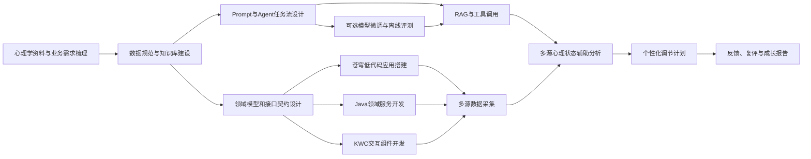
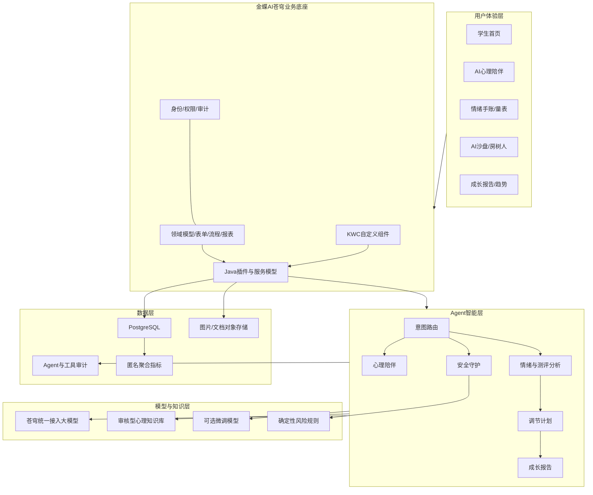

# 心迹AI：大学生心理辅助测评与智能陪伴平台整体技术路线

版本：V1.0  
适用赛题：中国软件杯 A6“新质校园智能体应用”  
核心底座：金蝶AI苍穹低代码平台、苍穹Agent平台  
开发语言与数据：Java、KWC、PostgreSQL

## 1. 项目定位

“心迹AI”面向大学生日常心理健康自助关怀场景，聚焦学业压力、人际关系、睡眠困扰、自我认同和职业焦虑等常见问题，构建一个集AI心理陪伴、情绪手账、心理量表、AI沙盘、房树人辅助分析、个性化调节计划和心理成长报告于一体的AI原生应用。

项目以学生个体的低门槛自助服务为主线，以安全守护和专业求助引导为底线，形成以下最小闭环：

```text
主动表达
  → 多源状态采集
  → AI辅助分析
  → 个性化调节建议
  → 任务执行与反馈
  → 趋势复评
  → 必要时引导现实求助
```

产品不提供医学诊断，不替代心理咨询师和医疗机构。正式输出统一使用“辅助测评”“状态分析”“风险提示”“自助建议”和“进一步关注”等表述。

## 2. 技术建设目标

### 2.1 平台目标

- 以金蝶AI苍穹作为核心开发与运行底座。
- 使用苍穹领域模型、表单、流程、报表和服务模型承载业务。
- 使用KWC实现AI对话、趋势图、2D沙盘等高交互页面。
- 使用Java插件或服务实现量表计分、规则判断、数据处理和Agent工具。

### 2.2 AI目标

- 支持自然语言心理陪伴和心理知识问答。
- 建设可审核、可引用、可更新的心理健康RAG知识库。
- 通过Agent任务流完成意图识别、信息采集、风险校验、建议生成和报告汇总。
- 通过Tool Calling读取情绪趋势、保存测评、生成计划和创建安全事件。
- 探索沙盘、房树人图片、语音和书写轨迹等多模态输入。
- 通过Prompt优化和可选LoRA/QLoRA微调增强大学生心理场景适配能力。

### 2.3 工程目标

- 使用完全模拟的数据完成比赛展示。
- 核心功能具备接口契约、版本记录、审计记录和测试证据。
- 在苍穹环境尚未完全就绪时，通过本地Adapter和Mock服务并行开发。
- 环境就绪后能够将本地验证成果快速映射到苍穹平台。

## 3. 总体技术路线



路线采用“平台主线 + 创新增强线”双轨实施：

- 平台主线：苍穹低代码、KWC、Java插件、苍穹Agent、RAG和工具调用，保证比赛环境内完整运行。
- 创新增强线：自建训练数据、LoRA/QLoRA微调、多模态特征实验和模型对比评测，用于增强差异化能力；无法部署到比赛环境时，以离线评测和标准接口展示。

## 4. 总体架构



## 5. 分层技术设计

### 5.1 学生交互层

采用苍穹表单与KWC组件组合实现：

- 苍穹表单：基础画像、情绪打卡、量表填写、反馈记录、授权确认。
- KWC组件：流式AI对话、情绪日历、趋势图、沙盘拖拽画布、图片上传预览、成长报告。
- 前端只负责交互和轻量校验，不在浏览器内保存模型密钥或执行最终风险判断。

### 5.2 低代码业务层

使用苍穹平台完成：

- 用户心理档案、情绪手账、测评记录、沙盘作品、房树人作品、分析报告等领域模型。
- 测评提交、报告生成、安全提示、复评提醒等业务流程。
- 学生个人趋势和匿名聚合统计报表。
- 学生、心理内容审核员和系统管理员的角色权限配置。

### 5.3 Java服务扩展层

Java用于处理不适合直接放在表单或Agent中的确定性逻辑：

- PHQ-9、GAD-7、PSS等量表计分与版本管理。
- 情绪趋势、连续恶化、异常波动等规则计算。
- 风险词与量表阈值的确定性安全校验。
- 沙盘元素坐标、聚类、区域和关系特征提取。
- 房树人结构化观察项和图像元数据处理。
- Agent工具鉴权、参数校验、幂等、超时和审计。
- 报告数据聚合、脱敏和内容安全过滤。

### 5.4 Agent智能层

Agent不直接拥有数据库权限，所有读写通过受控工具完成。建议采用一个总控路由Agent加若干专业任务节点，而不是让多个Agent自由对话。

```text
用户输入
  → 安全预检查
  → 意图路由
      ├─ 心理陪伴与知识问答
      ├─ 情绪/手账分析
      ├─ 量表解释
      ├─ 沙盘辅助分析
      ├─ 房树人辅助分析
      └─ 成长报告生成
  → 安全后检查
  → 保存结构化结果与审计
  → 返回学生端
```

### 5.5 模型与知识层

- 基座模型：优先使用苍穹平台统一提供的DeepSeek、豆包或通义千问等模型。
- 知识增强：通过RAG提供可追溯的心理科普、量表说明和自助练习。
- 行为约束：通过系统Prompt、输出Schema、风险规则和安全后处理限制越界输出。
- 能力增强：条件允许时接入微调模型；否则保留离线推理和对比评测证据。

## 6. 核心业务链路

### 6.1 日常心理陪伴链路

```text
学生进入平台
  → 阅读并确认知情说明
  → 选择今日情绪和压力标签
  → 与心理陪伴Agent对话
  → Agent检索RAG知识库并给出带来源的建议
  → 创建1—3项调节任务
  → 学生完成练习并反馈效果
  → 系统更新个人趋势
```

### 6.2 多源辅助测评链路

```text
情绪手账 + 心理量表 + AI对话摘要
  + 可选沙盘结构 + 可选房树人观察项
  → Java服务完成规则化特征处理
  → 分析Agent生成分模块摘要
  → 成长报告Agent汇总
  → 输出情绪主题、压力来源、保护因素、建议练习和复评时间
```

多源分析遵循“纵向趋势优先、单次结果弱解释”的原则。任何单次绘画、沙盘或对话均不能单独决定风险等级。

### 6.3 安全守护链路

```text
输入内容
  → 确定性规则与量表阈值并行检测
  → 安全守护Agent语义复核
  → 生成风险提示等级及依据
  → 普通风险：提供自助建议和复评提醒
  → 高风险：停止普通分析，展示现实求助指引并生成模拟安全事件
```

高风险事件不能只依赖大模型判断，也不能由Agent自动关闭。比赛阶段使用模拟求助资源和模拟事件，不发送真实通知。

## 7. 核心功能与优先级

### 7.1 P0：可参赛MVP

1. 知情说明、学生基础画像和隐私设置。
2. AI心理陪伴与RAG知识问答。
3. 情绪打卡和情绪手账。
4. 至少一种心理量表，优先GAD-7或PHQ-9。
5. 个人情绪趋势和心理成长报告。
6. 个性化调节计划、任务反馈与复评提醒。
7. 确定性风险规则、安全守护Agent和现实求助提示。
8. Agent工具调用轨迹、知识引用和运行审计。

### 7.2 P1：差异化创新

1. AI沙盘：元素选择、拖拽、关系计算、文字说明和辅助分析。
2. 房树人：图片上传、结构化问卷和非诊断性辅助分析。
3. 多源状态汇总和个人纵向变化对比。
4. 语音倾诉或冥想语音引导。
5. 自建模型数据集与LoRA/QLoRA离线评测。

### 7.3 P2：校园协同拓展

- 心理咨询预约和专业转介。
- 心理教师工作台。
- 匿名群体趋势和服务资源看板。
- 辅导员仅接收经授权、经人工复核的关爱任务。

P0必须先于P1完成。若工期紧张，AI沙盘与房树人二选一做深，不应同时交付两个不稳定的演示模块。

## 8. Agent设计

| Agent/节点 | 主要职责 | 主要输入 | 主要输出 |
|---|---|---|---|
| 意图路由Agent | 判断陪伴、知识问答、记录、测评、沙盘、报告或安全意图 | 当前输入、会话摘要 | 意图、置信度、下一节点 |
| 心理陪伴Agent | 倾听、共情、澄清和自助建议 | 用户表达、RAG片段 | 支持性回应、建议动作、引用 |
| 情绪分析Agent | 提取情绪、强度、事件和保护因素 | 对话摘要、手账 | 结构化情绪标签 |
| 量表解释Agent | 将确定性计分转为易懂说明 | 量表版本、分数、规则结果 | 非诊断性解释、复评建议 |
| 沙盘分析Agent | 分析元素、位置、关系和用户说明 | 结构化沙盘数据 | 主题摘要、自我探索问题 |
| 房树人分析Agent | 综合观察项和用户自述 | 结构化特征、图片描述 | 观察摘要、自我探索问题 |
| 调节计划Agent | 组合适合当前状态的微任务 | 状态摘要、内容库 | 任务、频次、反馈方式 |
| 成长报告Agent | 汇总不同时间与来源的数据 | 模块摘要、趋势 | 个人成长报告 |
| 安全守护Agent | 识别危机、越界医疗请求和危险建议 | 输入、规则结果 | 安全等级、固定处置动作 |

所有Agent输出优先采用JSON Schema，例如：

```json
{
  "primaryEmotion": "焦虑",
  "intensity": 3,
  "possibleStressors": ["考试", "睡眠不足"],
  "protectiveFactors": ["愿意主动求助"],
  "riskLevel": "yellow",
  "evidenceRefs": ["diary:mock-001", "assessment:mock-003"],
  "suggestedActions": ["完成3分钟呼吸练习", "三天后复评"],
  "disclaimer": "仅供自我探索和辅助参考"
}
```

## 9. Tool Calling设计

| 工具 | 作用 | 是否写数据 | 关键控制 |
|---|---|---:|---|
| `search_psychoeducation` | 检索心理知识库 | 否 | 返回来源和版本 |
| `get_emotion_trend` | 查询个人聚合趋势 | 否 | 仅访问当前用户 |
| `save_emotion_diary` | 保存情绪手账 | 是 | 参数校验、幂等 |
| `score_assessment` | 量表确定性计分 | 是 | 量表版本和完整性校验 |
| `save_sandbox_record` | 保存沙盘元素与布局 | 是 | 坐标范围、元素白名单 |
| `save_htp_record` | 保存图片引用和观察项 | 是 | 文件类型、安全扫描 |
| `create_care_plan` | 创建调节计划 | 是 | 内容库白名单 |
| `generate_growth_report` | 创建报告任务 | 是 | 多源数据授权检查 |
| `create_safety_event` | 创建模拟安全事件 | 是 | 规则触发、禁止Agent关闭 |

每个工具必须定义输入/输出Schema、调用角色、幂等键、超时、重试、错误码、日志脱敏和失败回退文案。

## 10. RAG知识库路线

### 10.1 知识域

- 大学生常见心理困扰科普。
- 焦虑、压力、睡眠、人际关系、考试和就业专题。
- PHQ-9、GAD-7、PSS等量表说明和使用边界。
- CBT基础技巧、正念、呼吸、冥想和行为激活练习。
- 沙盘和房树人的基础资料、争议与解释边界。
- 校园心理服务和现实求助资源。
- AI安全回应、危机提示和医疗越界拒答规范。

### 10.2 建库流程

```text
来源登记
  → 版权与适用性检查
  → 心理专业内容审核
  → 清洗、切分和元数据标注
  → 向量化与索引
  → 标准问题集评测
  → 发布
  → 版本更新与下架
```

文档元数据至少包括：来源、发布机构、主题、适用人群、审核人、审核日期、版本、生效时间、失效时间和风险标签。

### 10.3 检索策略

- 先按主题、受众和风险标签过滤，再进行语义检索。
- 对高风险问题优先返回安全SOP和现实求助资源。
- 回答展示来源标题；检索证据不足时明确说明，不允许补写“看似专业”的结论。
- 知识库内容本身不得直接触发高权限工具。

## 11. 多模态技术路线

### 11.1 AI沙盘

MVP不依赖图像识别，直接采集结构化布局数据：

```text
元素ID + 类别 + 坐标 + 旋转 + 缩放 + 层级
  → 区域划分
  → 距离/邻接/聚类计算
  → 用户文字解释
  → 沙盘分析Agent
  → 主题摘要和自我探索问题
```

沙盘输出只描述可观察结构、用户自述和可能的探索方向，不使用固定符号含义直接推断人格或疾病。

### 11.2 房树人辅助分析

分两步实现：

- MVP：图片上传 + 用户自述 + 结构化观察问卷。
- 增强版：使用苍穹可接入的多模态模型生成客观画面描述，再由Agent结合用户自述生成探索问题。

多模态模型只负责“看到了什么”，不能直接完成心理结论。最终输出应区分：客观观察、用户解释、AI辅助推测和建议行动。

### 11.3 语音与书写轨迹

- 语音倾诉：语音转写后进入与文本相同的安全链路；原始音频默认不长期保存。
- 书写轨迹：采集速度、停顿和笔划序列，用于个人纵向变化研究，不建立疾病分类器。

## 12. 自建/微调模型路线

### 12.1 定位

微调不作为比赛主链路的单点依赖，而用于增强中文大学生语境、回应风格、结构化输出稳定性和安全拒答能力。

### 12.2 数据准备

```text
公开且可使用的心理科普材料
+ 团队自建大学生场景对话
+ 量表解释样例
+ 沙盘/房树人结构化分析样例
+ 危机识别、安全拒答与转介样例
  → 去重、去隐私、来源登记
  → 心理专业审核
  → 训练/验证/测试集隔离
```

训练数据不得来自真实学生聊天记录。高风险样例采用人工构造或合规公开数据，并进行严格审核。

### 12.3 训练方案

- 候选基座：适合中文指令跟随的Qwen、DeepSeek等开源模型。
- 方法：SFT + LoRA/QLoRA；优先训练结构化输出和安全边界，不宣称训练“诊断能力”。
- 产物：数据版本、训练配置、日志、权重说明、评测报告和推理接口契约。

### 12.4 评测指标

- 共情与支持性。
- 心理知识事实一致性。
- 建议可执行性。
- 医疗越界拒答正确率。
- 风险表达召回率与误报情况。
- JSON结构遵循率。
- RAG引用一致性。
- 沙盘/房树人“观察与推测分离”程度。

### 12.5 接入策略

```text
比赛主方案：苍穹统一模型 + RAG + Prompt + Agent工作流
增强方案：Java适配器调用独立微调模型推理接口
无法接入时：展示离线评测、对比案例、训练日志和标准接口
```

## 13. 数据模型

| 模型 | 用途 | 苍穹实现建议 |
|---|---|---|
| `student_profile` | 学生基础偏好和匿名标识 | 领域模型/基础资料 |
| `consent_record` | 知情说明与授权版本 | 单据/审计记录 |
| `ai_chat_session` | 对话会话和摘要 | 业务对象 |
| `ai_chat_message` | 对话消息引用 | 敏感数据分权存储 |
| `emotion_diary` | 情绪、压力、睡眠和手账 | 动态表单 |
| `assessment_record` | 量表答案、版本和分数 | 单据 + Java计分插件 |
| `sandbox_record` | 沙盘主题和用户说明 | 主单据 |
| `sandbox_element` | 元素、坐标和关系 | 明细实体 |
| `htp_record` | 图片引用、自述和观察项 | 单据 + 附件 |
| `intervention_plan` | 个性化调节计划 | 业务对象 |
| `intervention_task` | 调节任务和反馈 | 明细/任务流程 |
| `ai_analysis_report` | 分析摘要和成长报告 | 业务对象/报表 |
| `safety_event` | 模拟安全事件和处置状态 | 流程单据 |
| `knowledge_document` | RAG来源和审核状态 | 知识资产清单 |
| `agent_run` | Agent版本、耗时和结果 | 运行审计 |
| `tool_call_record` | 工具参数摘要和执行状态 | 运行审计 |
| `model_eval_record` | 模型/Prompt评测结果 | 评测报表 |

身份数据、心理内容、AI分析结果和审计数据应分级授权。管理统计只使用匿名聚合数据。

## 14. 本地开发与苍穹环境边界

### 14.1 本地可完成

- 用户故事、流程、ER图、权限矩阵和接口契约。
- Java量表计分、风险规则、趋势计算、沙盘特征和脱敏逻辑。
- PostgreSQL DDL、索引、模拟数据和聚合查询。
- KWC组件的交互逻辑与静态原型。
- Prompt、工具Schema、Agent状态机和RAG语料清洗。
- 模型微调、离线推理、AI安全评测和对比实验。
- 自动化测试、PPT、视频分镜和设计说明书。

### 14.2 必须依赖苍穹环境

- 正式领域模型、动态表单、流程、报表和服务模型。
- KWC组件注册、平台生命周期和平台API联调。
- Java插件SDK编译、部署、日志、事务和权限验证。
- Agent创建、模型接入、知识库索引、任务流和工具注册。
- 平台组织权限、审计、安装包导出和跨环境安装。

### 14.3 迁移机制

- 先冻结OpenAPI和JSON Schema，再分别实现本地Mock Adapter与苍穹Adapter。
- 维护“概念字段—苍穹字段—数据库字段—API字段”映射表。
- 将Prompt、工具Schema、知识元数据和评测集纳入版本管理。
- 环境到位后先验证一个最小表单、一个Java插件、一次RAG和一次工具调用，再扩展完整业务。

## 15. 分阶段实施路线

### 阶段一：技术预研与契约冻结

- 冻结P0范围和演示故事。
- 完成领域模型、接口Schema、页面原型和风险边界。
- 建立模拟数据、知识来源清单和Agent评测集。

验收：核心ER图、OpenAPI初稿、6个核心页面、30条RAG问答、50条AI评测样例。

### 阶段二：学生自助MVP

- AI陪伴、RAG、情绪手账和一种量表。
- 调节计划、任务反馈、趋势和成长报告。
- 安全规则、Agent安全节点和模拟安全事件。

验收：一条普通压力故事和一条安全风险故事完整运行。

### 阶段三：创新能力增强

- AI沙盘或房树人择一做深。
- 多源分析和个人纵向对比。
- 自建数据集与微调模型离线评测。

验收：创新模块有结构化输入、Agent轨迹、评测数据和边界说明。

### 阶段四：苍穹深度集成

- 完成领域模型、表单、流程、报表、KWC和Java插件部署。
- 完成Agent、RAG和工具注册。
- 完成权限、审计、安装和跨环境验证。

验收：比赛租户中端到端运行，安装包可复现。

### 阶段五：交付与演示优化

- 功能、AI、安全、兼容性和安装测试。
- 方案PPT、7分钟视频、系统设计说明书和测试报告。
- 模型超时、网络异常和演示失败的降级预案。

## 16. 技术验收指标

| 类别 | 建议指标 |
|---|---|
| 业务完整性 | P0两条故事端到端成功，状态与审计可追踪 |
| RAG质量 | 回答具备来源；无证据问题能够拒绝编造 |
| Agent质量 | 意图路由、工具参数、结构化输出有离线评测记录 |
| 安全性 | 医疗越界、提示注入、危机表达和隐私泄露测试通过 |
| 工具可靠性 | 写操作幂等，超时和失败有回退，不重复生成记录 |
| 用户体验 | AI调用有加载/取消/重试，核心页面无阻断缺陷 |
| 平台能力 | 低代码、KWC、Java插件、Agent、RAG、报表均有演示证据 |
| 可交付性 | 干净环境可安装，模拟数据可初始化，材料版本一致 |

## 17. 比赛演示路线

建议7分钟演示聚焦一条主故事，创新能力穿插展示：

```text
学生进入心迹AI并确认知情说明
  → 完成今日情绪打卡
  → 向心理陪伴Agent表达考试焦虑
  → Agent通过RAG给出带来源的调节建议
  → 完成GAD-7量表并获得非诊断性解释
  → 进入AI沙盘或房树人创新模块
  → 多源分析生成个人成长报告
  → 创建三天调节计划并完成一次反馈
  → 展示趋势、Agent编排、工具调用和安全守护证据
```

演示应突出“苍穹平台如何承载业务”和“Agent如何真正执行任务”，不能只展示聊天界面。

## 18. 关键风险与技术取舍

| 风险 | 技术取舍 |
|---|---|
| 官方环境较晚开放 | 契约驱动、本地Mock、环境首日最小验证 |
| 微调模型无法部署 | 主链使用苍穹模型；微调作为离线创新证据 |
| 沙盘与房树人开发量过大 | P0不依赖；P1二选一做深 |
| 心理解释缺乏科学边界 | 观察与推测分离、专业审核、非诊断性措辞 |
| 大模型风险漏报 | 确定性规则与Agent并行，保守升级 |
| Agent工具误操作 | 最小权限、Schema校验、幂等、审计、人工确认 |
| 真实数据合规风险 | 全部使用人工构造模拟数据和公开合规语料 |

## 19. 最终技术路线总结

心迹AI的最终技术路线可概括为：

```text
以金蝶AI苍穹低代码平台为业务底座
+ 以KWC构建学生端多模态交互
+ 以Java实现确定性领域服务和Agent工具
+ 以PostgreSQL承载结构化业务数据
+ 以苍穹Agent实现RAG、编排、工具调用和安全守护
+ 以沙盘/房树人构建差异化多模态辅助表达
+ 以可选模型微调和离线评测形成创新证据
  → 构建“表达—分析—调节—反馈—复评”的大学生心理自助关怀闭环
```

实施时遵循“闭环优先、平台优先、安全优先、创新可验证”的原则：先保证苍穹平台上的P0链路稳定，再逐步增加沙盘、房树人和模型微调等创新能力。
