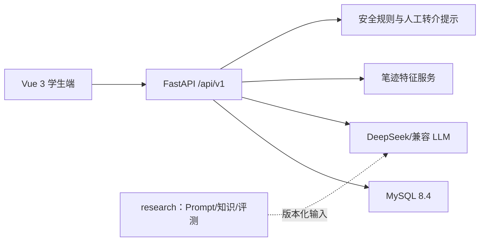

# 系统架构

## 边界

- `frontend` 只负责交互和本地 Canvas 采集，不保存模型密钥，不作最终风险判断。
- `backend` 统一提供业务 API、数据校验、AI 调用、安全降级和审计扩展点。
- `research` 保存公开研究资产和可复现实验脚本，不包含生产运行依赖和真实参与者数据。
- MySQL 保存业务数据；后续需补充字段级加密、身份映射分离、授权撤回与留存策略。

## API 基线

- `GET /health`：服务健康状态。
- `GET /api/v1/modules`：立项功能范围与阶段。
- `POST /api/v1/ai/chat`：支持性对话与危机规则兜底。
- `GET/POST /api/v1/wellbeing/moods`：情绪和压力记录。
- `GET/POST /api/v1/wellbeing/journals`：电子手账。
- `GET /api/v1/wellbeing/resources`：冥想与科普内容。
- `POST /api/v1/handwriting/analyze`：非诊断性笔迹行为分析。
