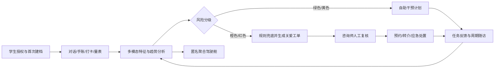
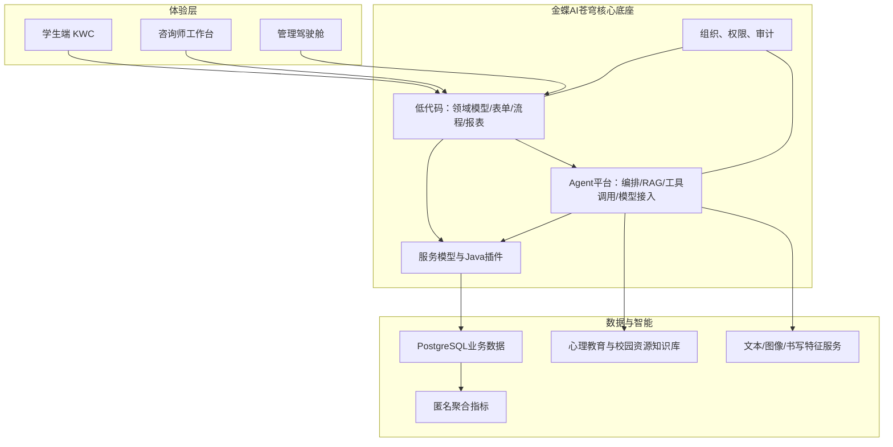

# 心迹AI项目总方案

版本：0.1（赛题适配稿）  
适用赛题：中国软件杯 A6“新质校园智能体应用”  
项目基础：目录内《心迹ai——大学生心理健康智能交互平台立项报告1.docx》及赛题要求

## 1. 项目摘要

心迹AI面向高校学生“有压力但不愿求助、咨询资源有限、风险发现滞后、服务过程难跟踪”的问题，建设一套以金蝶AI苍穹为核心底座的校园心理关爱平台。

平台允许学生通过对话、情绪打卡、电子手账和可选的绘画/书写交互表达状态；多个Agent在经过授权和最小化采集的前提下完成意图路由、知识检索、情绪趋势分析、干预计划生成和风险分级；低风险用户得到个性化自助任务，中高风险事件进入专业人员复核、预约转介和随访流程；管理人员只查看匿名聚合趋势与资源负载。全过程留有可解释依据、操作审计和人工接管点。

项目的核心不是“聊天机器人”，而是一条完整业务闭环：

## 2. 赛题适配策略

| 评分项 | 项目应答 | 可演示证据 |
|---|---|---|
| 功能完整性与业务闭环 30% | 学生表达、AI评估、自助干预、风险工单、咨询师复核、预约转介、随访复盘 | 两条端到端故事：普通压力与高风险事件 |
| 苍穹平台运用能力 25% | 领域模型、动态表单、工作流、报表、Java插件、服务模型、KWC、Agent平台 | 平台模型清单、流程轨迹、插件调用日志、安装包 |
| AI功能质量 20% | RAG、工具调用、多步编排、多Agent协同、多模态输入、可解释输出 | Agent运行轨迹、引用来源、工具执行回执、评测集 |
| 用户体验 15% | 学生端低压力表达、明确隐私提示；咨询师端高效研判；管理端匿名趋势 | 核心页面与无障碍/响应式测试 |
| 综合表现 10% | 政策价值、原创性、真实可落地、安全伦理、7分钟叙事 | PPT、视频、设计说明书、测试报告 |

原立项报告中的 JavaFX 不适合作为本赛题主前端，应改为 KWC；Java继续用于苍穹插件、复杂业务服务或本地可测试的领域逻辑。房树人、沙盘和笔迹特征保留为“辅助表达与趋势观察”，不得输出诊断结论，建议放在增强版而非首个MVP。

## 3. 用户角色和核心故事

### 3.1 学生

- 匿名或实名模式下完成知情同意、隐私选择和首次状态建档。
- 用自然语言倾诉，Agent以支持性方式回应并引用可信心理教育资料。
- 记录情绪、睡眠、压力事件和手账，查看个人趋势。
- 获取可执行的冥想、呼吸、运动、认知重构等微任务并反馈效果。
- 在需要时预约校内咨询；高风险时看到清晰的即时求助入口。

### 3.2 心理咨询师/辅导员

- 在最小权限下查看分配给自己的关爱工单，而不是任意浏览学生记录。
- 查看风险依据、趋势摘要和Agent建议，人工确认或调整分级。
- 完成联系、预约、转介、随访及结案，记录处置结果。
- 对Agent结论进行“采纳/修正/驳回”反馈，形成评测数据。

### 3.3 心理中心管理员

- 配置量表、内容、预案、值班资源和风险规则版本。
- 查看匿名聚合的院系趋势、主题分布、工单时效和资源负载。
- 审核知识库内容与Agent版本，检查审计记录。

### 3.4 系统管理员

- 管理角色、权限、组织、服务配置和部署，不读取心理内容。

## 4. 产品范围

### 4.1 P0：比赛可交付闭环

1. 学生授权与隐私设置。
2. AI陪伴对话，具备RAG引用和安全拒答。
3. 情绪打卡、电子手账、PHQ-9/GAD-7等量表记录。
4. 情绪趋势与风险分级（规则 + 模型建议 + 人工确认）。
5. 个性化自助干预计划、任务反馈和定期随访。
6. 高风险关爱工单、咨询师复核、预约/转介、结案。
7. 学生个人趋势页、咨询师工作台、匿名管理驾驶舱。
8. 权限、审计、数据留存和模拟数据方案。

### 4.2 P1：增强创新

- 绘画/房树人图片上传，AI只描述可观察特征并给出非诊断性提示。
- Canvas/KWC书写轨迹采集：速度、停顿、笔划等，仅做个人纵向变化辅助。
- 冥想或呼吸练习的语音引导。
- 多Agent复核与结论一致性校验。
- 咨询资源排班优化与趋势预测。

### 4.3 明确不做

- 自动医学诊断、处方或替代专业治疗。
- 用单次对话、绘画或笔迹直接判定心理疾病。
- 未经授权将私人对话暴露给辅导员、家长或管理人员。
- 真实学生数据、真实联系方式或真实危机通知。
- 为追求功能数量而加入与闭环无关的社交、商城等模块。

## 5. 业务流程与状态

### 5.1 普通关爱流程

授权建档 → 情绪表达 → Agent检索与回应 → 生成摘要/趋势 → 推荐微任务 → 学生执行反馈 → 3/7天随访 → 调整计划或结束。

### 5.2 风险事件流程

风险信号出现 → 关键词/规则同步兜底 → 风险评估Agent给出“证据 + 不确定性 + 建议等级” → 创建关爱工单 → 专业人员确认 → 联系/预约/转介 → 随访 → 结案复盘。

建议工单状态：`待复核`、`已确认`、`联系中`、`已预约`、`已转介`、`随访中`、`已结案`、`误报关闭`。

风险等级仅用于服务优先级：

| 等级 | 示例 | 系统动作 |
|---|---|---|
| 绿色 | 状态稳定，无明显风险 | 常规支持与内容推荐 |
| 黄色 | 持续压力、轻度量表异常 | 加密随访频次，建议预约 |
| 橙色 | 明显恶化或较强风险信号 | 生成高优先级工单，人工尽快复核 |
| 红色 | 明确、紧迫的自伤/他伤风险表达 | 中断普通生成，展示即时安全指引并触发模拟应急流程 |

实际阈值和处置SOP必须由有资质的心理专业人员审核。比赛演示只使用预设模拟账号和模拟通知。

## 6. 总体技术架构

### 6.1 分层职责

- KWC体验层：对话流、情绪日历、手账、任务卡、工单工作台和图表；不在前端存储敏感密钥或做最终风险判断。
- 苍穹低代码层：业务对象、表单、流程、权限、审批/工单、报表和集成编排，是比赛展示重点。
- Java领域服务：复杂校验、风险规则、指标聚合、数据脱敏、第三方适配；以平台插件优先，独立微服务只在确有必要时使用。
- Agent层：对话路由、RAG问答、计划生成、工具调用和咨询师摘要；所有会改变业务状态的工具均需鉴权、参数校验、幂等和审计。
- 数据层：PostgreSQL保存结构化业务数据；知识库保存审核后的非敏感资料；对话原文与分析结果分区管理。

## 7. 技术栈

| 层次 | 选型 | 用途 | 备注 |
|---|---|---|---|
| 核心平台 | 金蝶AI苍穹低代码平台 | 模型、表单、流程、报表、权限、集成 | 必须作为核心底座 |
| 前端 | KWC + JavaScript/TypeScript + CSS | 端侧交互和自定义组件 | 以官方环境支持版本为准 |
| 后端 | Java，苍穹Java插件/服务 | 领域逻辑、规则、工具实现 | 本地用纯Java模块或Spring Boot适配层测试 |
| 数据库 | PostgreSQL | 业务、配置、审计、聚合数据 | DDL先本地验证，再映射平台模型 |
| Agent | 苍穹Agent平台 | RAG、任务流、多步规划、工具调用 | 模型经平台统一接入 |
| 模型 | DeepSeek/豆包/通义千问 | 文本理解与生成；可选多模态模型 | 通过配置切换，不写死供应商 |
| 可视化 | 苍穹报表 + KWC图表组件 | 趋势、工单、资源驾驶舱 | 只展示匿名聚合数据 |
| 测试 | JUnit 5、MockMvc/REST Assured、契约/端到端用例 | Java和接口验证 | 平台端补充人工/自动回归 |
| 协作 | Git、Markdown、OpenAPI、数据库迁移脚本 | 版本与契约管理 | 禁止提交密钥和真实数据 |

## 8. Agent与RAG设计

### 8.1 Agent角色

| Agent | 职责 | 允许调用的工具 | 关键输出 |
|---|---|---|---|
| 对话路由Agent | 识别倾诉、知识问答、记录、预约、危机等意图 | 知识检索、路由 | 意图、置信度、下一节点 |
| 陪伴支持Agent | 支持性回应、澄清、心理教育 | RAG检索、读取用户授权偏好 | 回应、引用、建议动作 |
| 评估与趋势Agent | 综合量表、打卡和历史趋势，提出服务优先级建议 | 查趋势、查量表、风险规则 | 等级建议、证据、不确定性 |
| 干预计划Agent | 组合可执行微任务 | 查内容、创建计划、写任务 | 计划、频次、复评点 |
| 危机分诊Agent | 识别紧迫风险并执行安全编排 | 创建工单、查询值班资源、模拟通知 | 处置级别、工单回执 |
| 咨询师助手Agent | 压缩历史信息，辅助随访和结案 | 查授权范围内记录、写复核意见 | 可追溯摘要、待确认建议 |

危机检测不能只依赖大模型。确定性关键词/规则、量表阈值和短期恶化趋势与Agent并行，取更保守的结果进入人工复核。Agent不得自行关闭高风险工单。

### 8.2 工具清单

- `search_psychoeducation(query, audience)`：检索审核过的心理教育资料。
- `get_student_trend(studentId, range)`：读取授权范围内的聚合趋势。
- `save_mood_checkin(payload)`：保存打卡，返回业务单号。
- `create_care_plan(studentId, tasks)`：创建自助计划。
- `create_risk_case(evidence, suggestedLevel)`：创建关爱工单，不允许Agent直接结案。
- `list_available_slots(serviceType)` / `book_appointment(slotId)`：查询并预约。
- `record_followup(caseId, result)`：记录专业人员确认后的随访。

每个工具都要有输入JSON Schema、权限范围、超时、重试、幂等键、审计字段和失败回退文案。

### 8.3 知识库

知识域建议分为：国家与学校心理健康政策、心理科普、CBT/正念等自助材料、量表使用说明、校园咨询资源、危机处置SOP、常见问题。

入库流程：来源登记 → 专业审核 → 切分与元数据标注 → 索引 → 20~50个标准问题评测 → 发布 → 版本化更新/下架。

必要元数据：`doc_id`、标题、来源、发布机构、适用人群、主题、风险等级、审核人、审核日期、版本、生效/失效时间。回答应返回来源标题和片段标识；检索不足时明确说明并引导专业求助，不得编造。

## 9. 数据模型

建议核心实体：

| 实体 | 主要字段 | 说明 |
|---|---|---|
| student_profile | id、匿名标识、授权版本、偏好 | 身份映射与心理数据分离 |
| consent_record | student_id、scope、version、granted_at、revoked_at | 可追溯知情同意 |
| conversation/session | session_id、channel、started_at、summary | 原文与摘要可分表、分权限 |
| mood_checkin | mood、stress、sleep、tags、occurred_at | 日常纵向趋势 |
| journal_entry | content_ref、emotion_tags、visibility | 默认仅本人可见 |
| assessment/answer | scale_code、version、score、submitted_at | 量表版本化，不直接等同诊断 |
| risk_signal | source、evidence_ref、rule_version、suggested_level | 保存机器建议与解释 |
| care_case | level、status、assignee、sla_due_at | 人工处置主单 |
| care_action | case_id、action_type、operator、result | 工单轨迹 |
| intervention_plan/task | plan_id、content_id、schedule、feedback | 自助干预闭环 |
| appointment | service_type、slot、status | 预约转介 |
| knowledge_document | source、version、review_status | RAG治理 |
| agent_run/tool_call | agent_version、input_ref、output_ref、latency、result | AI可观测性 |
| audit_log | actor、action、resource、result、occurred_at | 不可由普通业务用户修改 |

数据分级：公开知识（L1）、普通业务数据（L2）、心理健康敏感数据（L3）、危机和身份映射（L4）。L3/L4需要最小权限、传输/存储加密、访问审计和明确留存周期。管理驾驶舱只使用满足最小样本量的聚合指标，避免小群体反向识别。

## 10. 本地开发与官方环境边界

### 10.1 可在本地完成

- 需求、用户故事、流程图、ER图、接口契约、错误码和验收标准。
- Java平台无关领域逻辑：评分、趋势计算、风险规则、脱敏、审计封装及单元测试。
- Spring Boot模拟适配器（仅用于联调），模拟苍穹表单/流程/Agent工具接口。
- PostgreSQL DDL、迁移、索引、模拟数据和查询性能验证。
- KWC组件的纯前端逻辑、视觉稿或静态原型；具体运行范围取决于官方SDK是否可离线使用。
- Prompt、Agent状态机、工具JSON Schema、RAG文档清洗与离线评测集。
- 多模态特征概念验证；优先验证接口与解释性，不训练医疗模型。
- 自动化测试、PPT内容、视频分镜、设计说明书和测试报告框架。

### 10.2 必须依赖苍穹环境

- 正式领域模型、动态表单、单据、编码规则、流程服务和报表配置。
- 平台组织/角色/权限、单点登录、审计及数据权限验证。
- KWC在苍穹页面中的注册、生命周期、平台API调用与最终兼容性测试。
- Java插件使用苍穹SDK编译、上传、热部署、运行日志和事务验证。
- Agent创建、模型网关接入、RAG索引、任务流编排、工具注册与运行轨迹。
- 服务模型、集成服务、平台数据库连接和真实流程联调。
- 产品安装包导出、全新租户安装、初始化、升级/卸载验证。

### 10.3 双轨适配方法

1. 先定义平台无关业务接口和DTO，禁止本地业务代码直接依赖某个临时页面字段。
2. 本地通过Mock Adapter实现接口；苍穹环境通过Java插件/服务模型Adapter实现同一契约。
3. 业务对象维护“概念模型—苍穹实体—数据库表—API字段”四列映射表。
4. Agent工具先以OpenAPI/JSON Schema冻结输入输出，再在苍穹注册真实工具。
5. 每次平台配置变更导出可版本化资产或截图/清单，避免只存在个人租户。

### 10.4 环境到位后的首日验证清单

- 确认租户、开发者权限、平台版本、KWC版本、Java SDK/JDK版本和可用模型。
- 创建最小“情绪打卡”领域模型、表单和查询报表。
- 部署一个返回固定JSON的Java插件并查看日志。
- 创建一个最小Agent，完成一次RAG检索和一次工具调用。
- 验证角色数据权限、安装包导出和另一环境安装。
- 把验证结果写入 `docs/环境基线.md`，随后冻结实际技术版本。

## 11. 三人小组分工

采用“一人主责、另一人评审、关键闭环共同联调”，避免形成三个互不相通的模块。

| 成员 | 主责 | 具体交付 | 交叉评审 |
|---|---|---|---|
| A：产品/低代码/交付负责人 | 产品范围、苍穹低代码、项目管理、比赛材料 | 用户故事、领域模型、表单流程报表、权限矩阵、PPT、演示脚本、安装清单 | 评审C的交互和Agent话术 |
| B：Java/数据/质量负责人 | Java插件、数据库、安全、测试 | 领域服务、工具接口、DDL、模拟数据、规则引擎、审计、自动测试、测试报告 | 评审A的平台模型和C的工具契约 |
| C：KWC/Agent/体验负责人 | KWC界面、Agent编排、RAG、多模态 | 学生端与工作台、Prompt、工作流、知识库、离线评测、UI规范、视频录制 | 评审B的API可用性和A的演示流程 |

共同责任：每周一次端到端演示；高风险流程由三人共同评审；任何人不允许独占平台账号、部署步骤或关键文档。

推荐协作规则：

- 主分支始终可演示；功能分支小步合并，合并前至少一人评审。
- API、字段、Agent工具变更先改契约，再改实现。
- 每项需求必须有负责人、验收标准、演示账号和测试用例。
- 密钥只放平台密钥管理或本地未提交的环境变量；仓库只放示例配置。
- 每周五产出可播放的屏幕录制，提前暴露演示断点。

## 12. 建议里程碑（8周模板）

| 周次 | 目标 | 验收出口 |
|---|---|---|
| 第1周 | 范围冻结与环境摸底 | P0故事、ER图、页面图、权限矩阵、环境基线 |
| 第2周 | 数据与契约、本地骨架 | DDL、OpenAPI、模拟数据、核心Java单测 |
| 第3周 | 学生端主链路 | 授权、打卡、对话、手账可演示 |
| 第4周 | Agent与RAG | 引用问答、计划生成、工具调用评测通过 |
| 第5周 | 风险闭环 | 规则兜底、工单、复核、预约、随访端到端 |
| 第6周 | 驾驶舱与创新点 | 匿名看板；选做一个多模态能力，不同时铺开 |
| 第7周 | 稳定性与材料 | 回归测试、权限测试、安装测试、PPT初稿、视频粗剪 |
| 第8周 | 冻结与提交 | 无P0缺陷、全新环境安装成功、7分钟视频、PDF和安装包 |

如果时间不足，优先顺序为：闭环稳定 > 苍穹使用深度 > AI可解释与安全 > UI润色 > 多模态扩展。

## 13. 演示设计（不超过7分钟）

1. 0:00–0:35：痛点、目标、核心价值。
2. 0:35–1:10：架构与苍穹能力总览。
3. 1:10–2:50：学生普通压力场景——倾诉、RAG引用、打卡、计划。
4. 2:50–4:35：模拟高风险场景——规则兜底、Agent分诊、工单、人工复核、预约/随访。
5. 4:35–5:25：管理驾驶舱、资源负载和匿名趋势。
6. 5:25–6:20：Agent编排、工具调用、知识库、可解释和安全机制。
7. 6:20–7:00：创新、效果、落地价值与总结。

必须准备离线兜底：固定模拟账号、预热知识库、可复现输入、关键页面录屏、模型超时时的友好回退，不伪造实时结果。

## 14. 测试与验收指标

### 14.1 功能

- 两条核心用户故事全流程成功，关键状态可追踪。
- 工具重复调用不会重复建单/预约；失败有回退和人工入口。
- 不同角色只能看到授权范围内的数据。

### 14.2 AI质量

- 建立不少于50条离线评测样例，覆盖正常支持、知识问答、模糊表达、越界医疗请求、提示注入和危机表达。
- RAG回答引用命中率、事实一致性、拒答正确率和工具参数正确率有记录。
- 危机场景以“召回优先、人工复核”为原则；任何漏报都作为P0缺陷。
- Agent输出展示证据来源、不确定性，不展示虚构推理过程。

### 14.3 非功能

- 常规页面与接口达到演示环境可接受响应；大模型慢调用显示进度、可取消、可重试。
- 核心页面无阻断性错误，适配比赛演示分辨率。
- 输入校验、越权访问、日志脱敏、提示注入和敏感信息泄漏测试通过。
- 安装包在干净比赛环境完成安装、初始化、升级和回滚演练。

## 15. 安全、隐私和伦理

- 明示系统能力边界、数据用途、保存期限、撤回方式和紧急求助渠道。
- 默认最小采集；手账和对话不默认共享；身份映射与心理数据隔离。
- 对咨询师按工单授权，对管理员只开放匿名聚合，对系统管理员隔离内容权限。
- Agent提示词、知识来源、模型版本、工具调用和人工修改全程留痕。
- 防提示注入：知识内容不获得工具权限；工具参数在服务端重新校验；敏感工具需确定性策略或人工确认。
- 数据全部为模拟数据，生成规则避免映射真实学生；截图和视频也不得出现真实信息。
- 紧急提示需由学校专业人员和当地规范校准，不能仅复制通用热线文案。

## 16. 主要风险与应对

| 风险 | 影响 | 应对 |
|---|---|---|
| 苍穹环境晚到或版本不确定 | 集成延期 | 契约先行、Mock Adapter、首日最小验证、P0冻结 |
| 平台经验不足 | 配置返工 | 每种能力先做最小样例，再复制到业务模块；记录操作手册 |
| 功能铺得过宽 | 闭环不稳 | 房树人/沙盘/笔迹列为P1，只保留一个可验证创新点 |
| 大模型幻觉/误判 | 安全与评分风险 | 审核知识库、强制引用、规则兜底、人工复核、离线评测 |
| 演示网络或模型抖动 | 视频/答辩失败 | 预热、超时回退、固定数据、备用录屏 |
| 敏感数据泄漏 | 严重合规问题 | 模拟数据、最小权限、脱敏日志、访问审计 |
| 三人接口不一致 | 联调失败 | 契约驱动、周演示、交叉评审、共享部署文档 |

## 17. 必交材料映射

| 交付物 | 仓库位置 | 完成标准 |
|---|---|---|
| 完整源代码与安装包 | `kingdee/`、`local/`、`deliverables/package/` | 可在干净环境安装，含初始化和版本说明 |
| 创意方案PPT | `deliverables/ppt/` | 团队、需求、架构、演示、AI亮点、价值、分工 |
| 7分钟演示视频 | `deliverables/video/` | 核心闭环顺畅，突出苍穹与Agent证据 |
| 系统设计说明书PDF | `deliverables/design-spec/` | 数据模型、Agent、知识库、接口、部署、安全 |
| 测试报告 | `deliverables/test-report/` | 用例、结果、截图、缺陷与结论 |

## 18. 近期行动清单

环境未到位也应立即开始：

1. 三人确认P0范围、角色和两条演示故事，给成员A/B/C实名。
2. 完成核心实体ER图、状态机、权限矩阵和OpenAPI初稿。
3. 准备50~100个完全模拟的学生、打卡、量表、工单和预约数据。
4. 建立知识来源清单与审核规则，先做30条RAG标准问答。
5. 实现风险规则、趋势计算和工具契约的本地单元测试。
6. 画出6个核心页面：学生首页、AI对话、情绪趋势、干预计划、咨询师工单、管理驾驶舱。
7. 获取环境后执行首日验证清单，48小时内更新真实版本和限制。

